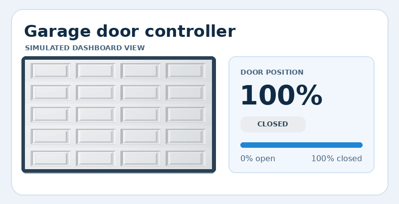
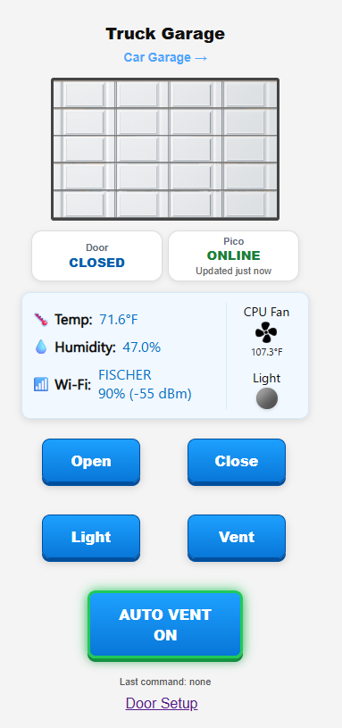
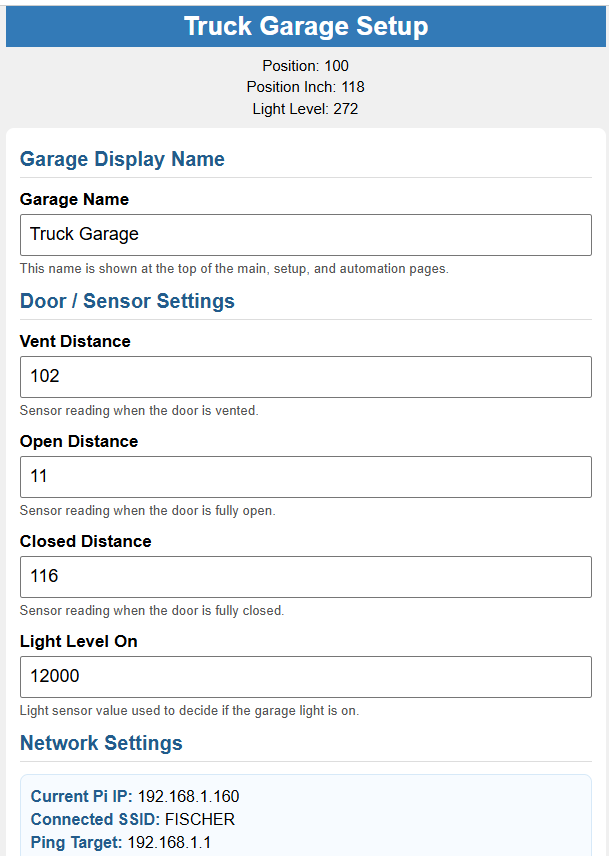
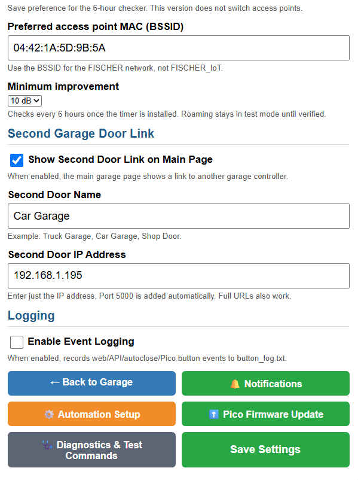

# Garage Door Controller

A Raspberry Pi Zero 2 W runs a local web dashboard. A Raspberry Pi Pico handles the garage opener interface, reads door position and environmental sensors, and reports its status to the Pi over UART.

*Simulated full travel. The live dashboard uses the same scale and shows a separate Vented state at the calibrated vent position.*

| Feature | What it does |
| --- | --- |
| Dashboard | Open, close, vent, and toggle the light. See door position, Pico health, temperature, humidity, Wi-Fi, and fan status. |
| Automation | Schedule a daily close and allow temperature-based venting during a configured time window. |
| Two doors | Add a dashboard link to another controller, such as the Car Garage from the Truck Garage. Each controller has its own Pi and Pico. |
| Diagnostics | Check the network and fan, inspect Pico status, and enable detailed event logging for troubleshooting. |
| Pico firmware | Check GitHub from the dashboard and transfer a newer `main.py` from the Pi to the Pico over UART. |

## Documentation

- [Installation, wiring, and first startup](docs/installation.md)
- [Dashboard, calibration, and automation](docs/operation.md)
- [Show your own vehicle in the dashboard](docs/operation.md#show-your-own-vehicle-behind-the-door)
- [Pico firmware installation, updates, and recovery](docs/firmware.md)
- [Architecture, endpoints, and troubleshooting](docs/reference.md)

## Dashboard screenshots

| Dashboard | Door and sensor setup | Network and door controls |
| --- | --- | --- |
|  |  |  |

## Repository layout

| Path | Contents |
| --- | --- |
| [app.py](app.py), [templates/](templates/), [static/](static/) | Flask dashboard and setup pages |
| [serial_reader.py](serial_reader.py), [fan_control.py](fan_control.py) | Pi-side Pico communication and enclosure fan |
| [deploy/](deploy/), [install.sh](install.sh) | Service definitions, example configuration, and installer |
| [pico/](pico/) | Firmware snapshot, support modules, and dependencies for a USB bootstrap |

The dashboard downloads updates from the separate [Pico OTA repository](https://github.com/RLF62/ota_garage_door_opener). This project includes a snapshot of its firmware at commit `4321b28998dc1124a532f241245752c33145b995`.

Keep the dashboard on a trusted local network. It has no application login, and its command endpoints can move a physical door.
