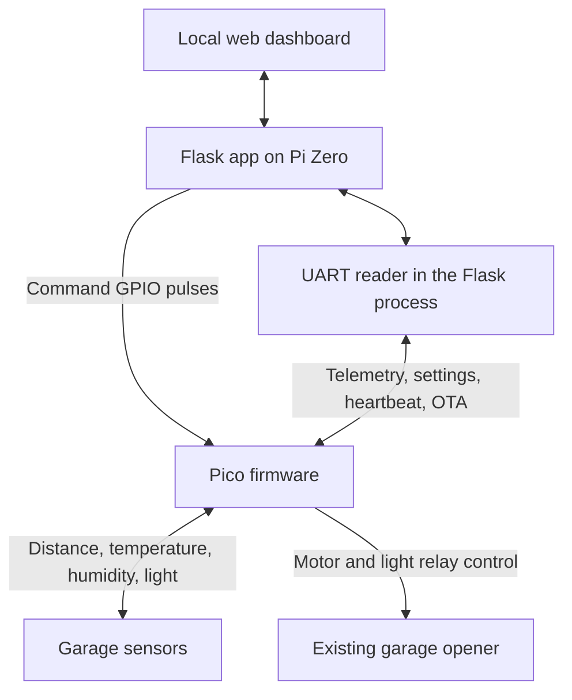

# Architecture and troubleshooting

[Back to project README](../README.md)

## How the controller fits together

The Pi's Open, Close, Vent, and Light command GPIOs idle high and pulse low for 0.4 seconds. UART uses `/dev/serial0` at 115200 baud and carries telemetry, acknowledgements, heartbeat, settings, and update traffic. Run one instance of the dashboard so that one process owns the serial port and automation threads.

[serial_reader.py](../serial_reader.py) reports the Pico offline after about 12 seconds without UART traffic and requests a hardware reset after about 30 seconds without a response. The daily reset window starts at 02:00 local time and ends at 02:05. [fan_control.py](../fan_control.py) uses BCM 16 and has 45 °C on and 40 °C off thresholds for the enclosure fan. The Pi CPU reading is independent of the garage's BME280 temperature.

## Services and state

| Item | Role |
| --- | --- |
| `garage.service` | Launches the Flask app, UART reader, fan control, and automation in one process. |
| `network-watchdog.service` | Optional network monitor. Checks every 60 seconds and can cycle Wi-Fi or reboot the Pi after repeated failures. |
| `garage-wifi-roam.timer` | Optional six-hour timer that invokes the Wi-Fi roaming check. It requires NetworkManager and a configured preferred access point. See [installation](installation.md#local-settings-and-optional-networking) before adapting it. |
| `vent_config.json`, `notify_config.json`, `diagnostics_config.json` | Local settings. Back these up privately when moving to another Pi. |
| `position.json`, `vent_status.json`, `temperature.json`, `pico_status.json` | Runtime telemetry and health. |
| `pico_settings_status.json`, `pico_update_status.json` | Calibration acknowledgement and firmware transfer result. |
| `app.log`, `status.log`, `auto_close.log`, `button_log.txt` | Web app, serial reader, scheduled close, and optional command source logs. |

## Read-only HTTP endpoints

All paths are on the local dashboard, typically port 5000. The endpoints below are GET requests.

| Path | Output |
| --- | --- |
| `/position`, `/position_in`, `/vent_status` | Text position percentage, measured inches, and vent state. |
| `/environment_temp`, `/environment_humidity`, `/cpu_temp` | Text temperature in °F, humidity percent, and Pi CPU temperature in °F. |
| `/system_status` | JSON containing `pico_online` and `last_update_sec`. |
| `/automation_status`, `/network_status`, `/api/wifi_roam_status` | JSON for automation, network watchdog, and roaming. |
| `/pico_update_status` | JSON with versions, comparison, transfer state, and error details. |

The dashboard also has state-changing endpoints. `POST /command` takes a JSON `command` string. The dedicated `/command/open`, `/command/close`, `/command/vent`, `/command/light`, and `/command/stop` routes accept GET and POST. A successful command response confirms a Pi GPIO pulse. Use door telemetry to verify the physical result. The current Pico firmware ignores the external Stop input. Never use the command URLs as health checks.

## Troubleshooting

Run these from the Pi unless a different location is specified.

| Symptom | What to check |
| --- | --- |
| Dashboard unreachable | Run `systemctl status garage.service --no-pager`, then `sudo journalctl -u garage.service -n 80 --no-pager`. Check the Pi IP and connect to port 5000. |
| Pico Offline | Check `/system_status`, then `readlink -f /dev/serial0` and `tail -n 60 status.log` from the installation folder. Check the shared ground, crossed UART TX/RX, serial login shell setting, and Pico power. |
| Door moves but status is wrong | Compare live inches with the calibration on Door Setup and inspect `pico_settings_status.json`. Check the LIDAR target and alignment with the door stopped. |
| Door moves unexpectedly | If safe to do so, use the opener's original control to stop movement. Review the **Auto Close** and **Auto Vent** settings and `button_log.txt` when event logging is enabled. Inspect `status.log` for Pico events. |
| Firmware reports the same version | Compare the numeric version parts. Descriptive suffixes alone do not trigger an update. See [firmware recovery](firmware.md#transfer-and-recovery). |
| Fan appears inactive | Compare Pi CPU temperature with the 45 °C threshold. Run **Fan Test** from Diagnostics and inspect `fan_status.json`. |
| Wi-Fi drops repeatedly | Check the dashboard's ping target, `journalctl -u network-watchdog.service --no-pager -n 50`, and `journalctl -u garage-wifi-roam.service --no-pager -n 50` if those services are enabled. |

For routine backups, copy the source, service definitions, and the three local settings files to a private location. Keep a known-good Pico firmware copy with its support modules for USB recovery.
