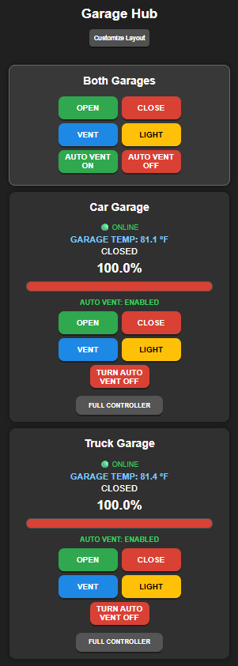

# Dual Garage Hub

The Hub brings two running [Garage Door Controllers](../README.md) into one browser dashboard. It shows door position, temperature, and Auto Vent state for each garage. The **Truck Garage**, **Car Garage**, and **Both Garages** cards provide individual and combined controls.



*Mobile dashboard with the Both Garages card moved to the top.*

## Install the Hub separately

Use a Raspberry Pi OS host that can reach both controller dashboards over the local network. The Hub uses port 5050 and needs no Pico, GPIO wiring, or serial connection of its own. Leave port 5050 available on the Hub host.

Clone the repo and enter the Hub folder. If you already cloned the repo, start in its `dual_garage` directory.

```sh
git clone https://github.com/RLF62/garage-door-controller.git
cd garage-door-controller/dual_garage
```

Install the Hub files and its service.

```sh
sudo apt update
sudo apt install python3-flask python3-requests gunicorn
sudo install -d -m 0755 /opt/dual-garage-hub/templates /opt/dual-garage-hub/static
sudo install -m 0644 app.py /opt/dual-garage-hub/
sudo install -m 0644 templates/index.html /opt/dual-garage-hub/templates/
sudo install -m 0644 static/icon.png /opt/dual-garage-hub/static/
sudo install -m 0644 dual-garage-hub.service /etc/systemd/system/
```

For the first install, copy the example configuration. Edit both URLs to match the addresses you use to open the individual garage dashboards, including their ports.

```sh
sudo install -m 0644 garage-hub.conf.example /etc/dual-garage-hub.conf
sudoedit /etc/dual-garage-hub.conf
```

```ini
TRUCK_GARAGE_URL=http://192.0.2.10:5000
CAR_GARAGE_URL=http://192.0.2.11:5000
```

The addresses above are examples. After setting yours, start the Hub.

```sh
sudo systemctl daemon-reload
sudo systemctl enable --now dual-garage-hub.service
```

Open `http://<hub-ip>:5050/` and check that both cards report **ONLINE**. **Full Controller** opens the individual door's dashboard. The Hub has no login and can move both doors. Keep port 5050 on your trusted local network.

## Arrange the cards

Select **Customize Layout**, then drag a card by its handle or use **Up** and **Down**. Select **Save Layout** to keep the order. The browser saves separate orders for desktop and phone-width views. **Cancel Editing** discards unsaved changes. To restore the original order, select **Reset Layout**, then **Save Layout**.

## Maintenance

- After changing either controller URL, run `sudo systemctl restart dual-garage-hub.service`.
- If a card reports **OFFLINE**, check that the Hub host can reach the controller URL in `/etc/dual-garage-hub.conf`. For Hub startup errors, run `sudo journalctl -u dual-garage-hub.service -n 50 --no-pager`.
- To update, pull the repo, repeat the file installation commands, then run `sudo systemctl daemon-reload` and `sudo systemctl restart dual-garage-hub.service`. Keep your existing configuration file.
